# Cloud Lab 4 Submission — Amazon VPC

- **Student name:** Lo Bunleang
- **Student ID:** e20220722
- **Learner Lab user name:** user_5624074
- **Date completed:** 06-Nov-2026

---

## VPC and internet gateway

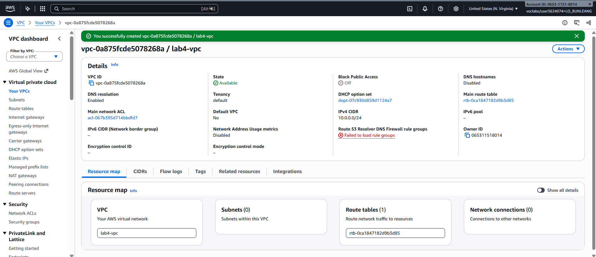

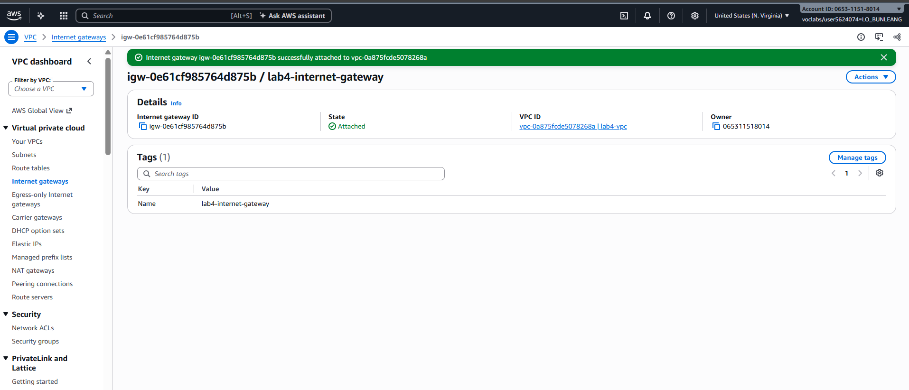

## Public subnet

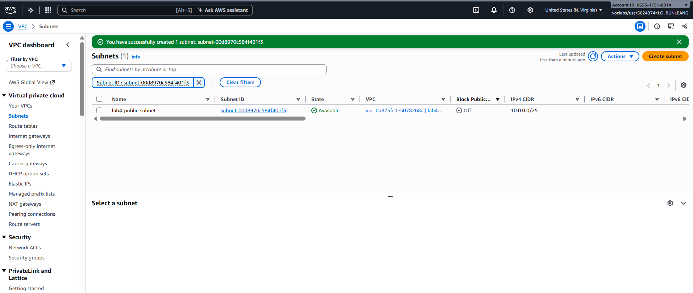

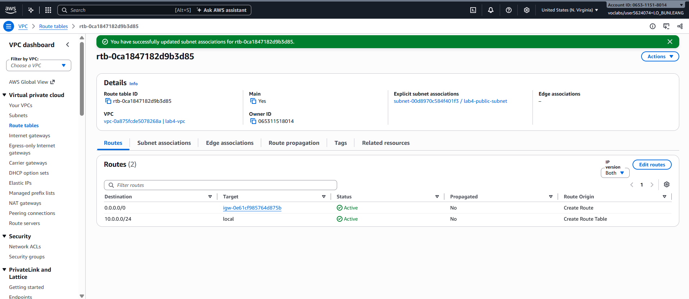

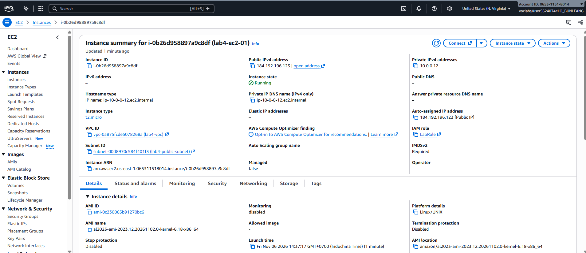

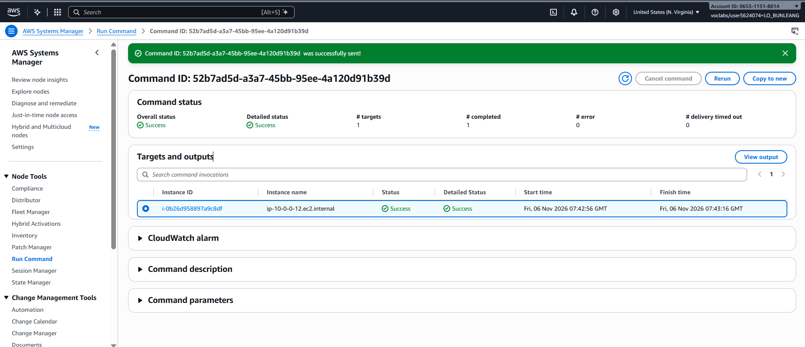

## Private subnet

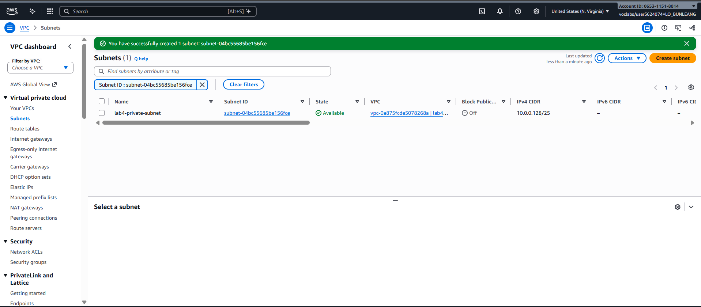

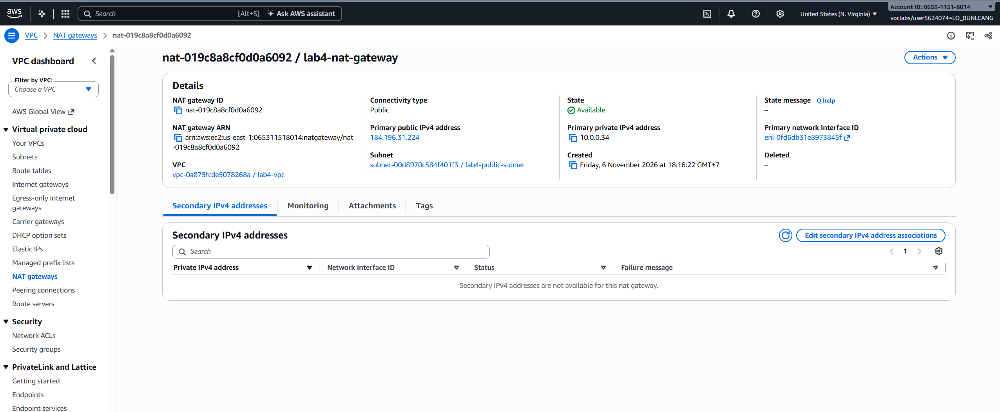

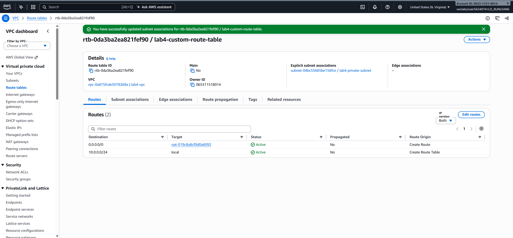

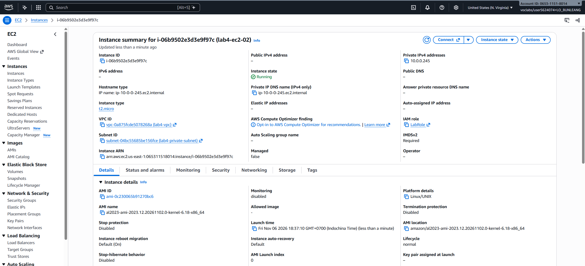

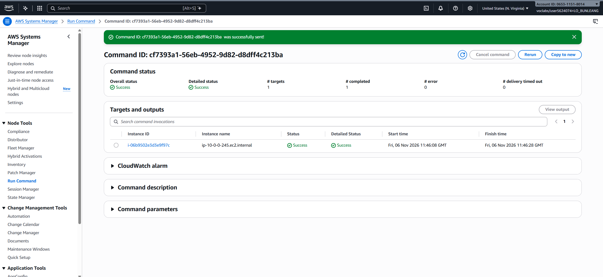

---

## Questions

1. A `/25` block contains `2^(32 - 25) = 128` IPv4 addresses. Each subnet therefore contains 128 addresses (AWS reserves 5 in each subnet, leaving 123 usable for instances). `10.0.0.0/25` covers `10.0.0.0`–`10.0.0.127`, while `10.0.0.128/25` covers `10.0.0.128`–`10.0.0.255`. Their ranges are adjacent and do not overlap; together they cover the VPC's `10.0.0.0/24` range.

2. The public subnet is associated with a route table that sends the default route (`0.0.0.0/0`) to the internet gateway. An instance also needs a public IPv4 address and suitable security rules to communicate directly with the internet. The private subnet is associated with a different route table whose default route points to the NAT gateway, not the internet gateway. The subnet names alone do not determine their public or private status; routing and addressability do.

3. A public NAT gateway needs a route to the internet through the internet gateway and an Elastic IP address. Placing it in the public subnet gives it that internet-gateway route. Instances in the private subnet can send outbound traffic through the NAT gateway, while the NAT gateway's address translation allows return traffic without exposing those instances to unsolicited inbound connections.

4. No. `lab4-ec2-02` has no public IP address, and the private subnet's route sends internet-bound traffic through the NAT gateway. An internet host cannot initiate a direct connection to the instance. The instance can download updates: its outbound connection goes through the NAT gateway, and the response traffic is returned through that established translation.

5. AWS Systems Manager needs the instance to be registered as a managed node so that Run Command can send commands to it. The attached instance role/profile supplies the permissions the SSM Agent needs to communicate with Systems Manager. The instance also needs network connectivity to the Systems Manager service. The screenshots show the `LabRole` role attached to both instances.

---

## Clean up

The screenshots show the instances running and the NAT gateway available, so cleanup is not confirmed as complete:

- [x] Instances terminated.
- [x] NAT gateway deleted and its Elastic IP released.
- [x] Internet gateway detached and deleted.
- [x] `lab4-vpc` deleted.